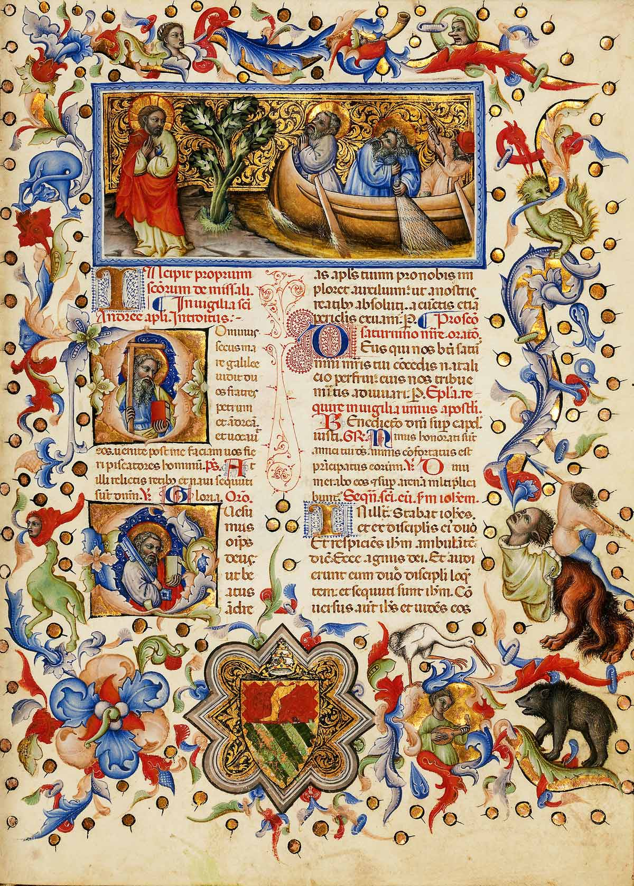
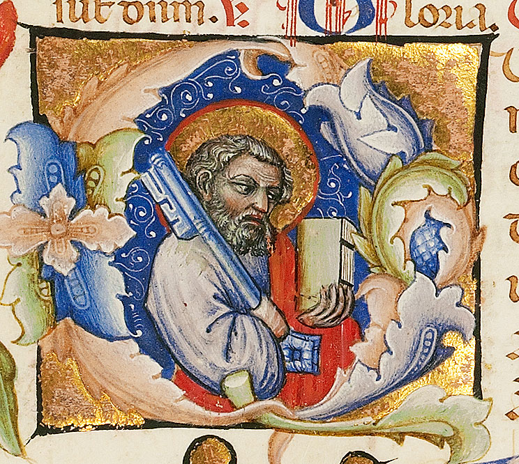
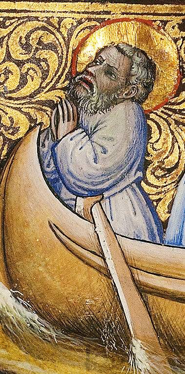
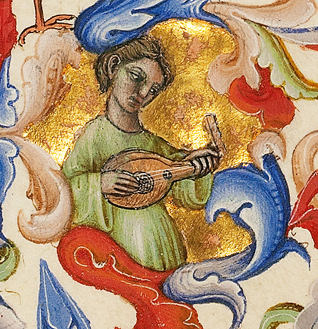
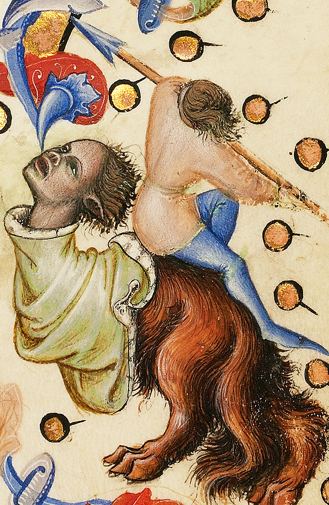
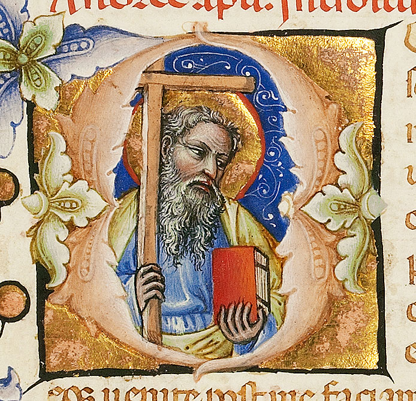
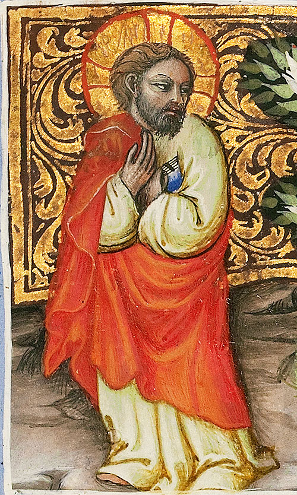

# The Calling of Saints Peter and Andrew – MS. 34, F. 172A

!!! info "Archived page"
    This page preserves the text of the [original DMMapp Blog page](https://blog.digitizedmedievalmanuscripts.org/beautiful-illuminated-manuscript-leaves/calling-saints-peter-andrew/).
    References to the former shop and support arrangements are historical.
    The original blog content was published under [CC0](https://creativecommons.org/publicdomain/zero/1.0/).
    Manuscript images retain their Getty Open Content attribution below.

Thanks to the [Getty’s Open Conten Program](https://www.getty.edu/about/opencontent.html), **this beautiful folio is also for sale on our store.** The income helps us maintain the Sexy Codicology blog and the DMMmaps project going!

This folio represents the Calling of Saints Peter and Andrew.

**This folio represents the Calling of Saints Peter and Andrew.** Opening to the section of the missal called the *Sanctorale*, which was devoted to the masses celebrated on Saint’s day beginning with the vigil of the feast of Saint Andrew.

In this leave from MS. 34, from the Gerry Museum we see Saint Andrew and Saint Peter casting their nets into the Sea of Galilee on the right; Jesus stands on the shore to the left. **Jesus is calling them to follow him and become “fishers of men”.**

The two apostles have just turned towards Jesus with expressions of awe. The boat glides toward the shore while Peter has dropped his oar and folded his hands in prayer. Andrew is standing behind him and his net, his eyes are set on Jesus.

Saint Andrew appears in the inhabited initial “D” (“Dominus”) found Below the miniature. He holds the cross upon which he was crucified.

Saint Peter appears below, in the initial Q with the key to heaven.

St. Peter holding the key.

St. Peter in awe.

Marginal detail: unidentified person playing a lute

Marginal Detail: Grotesque, rider and spear.

St. Andrew holding the cross.

Jesus calling St. Andres and St. Peter.

**Source: [Getty Museum, The Calling of Saints Peter and Andrew](https://www.getty.edu/art/collection/object/103RWN)**
