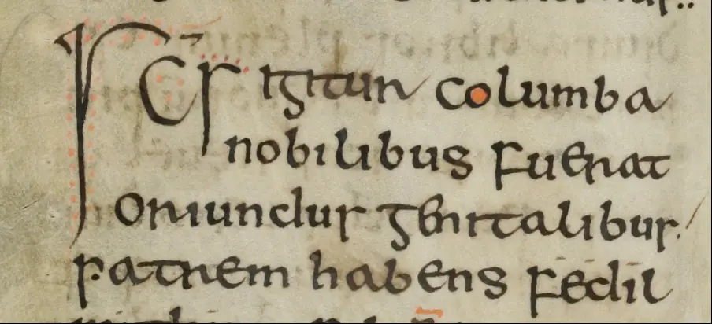
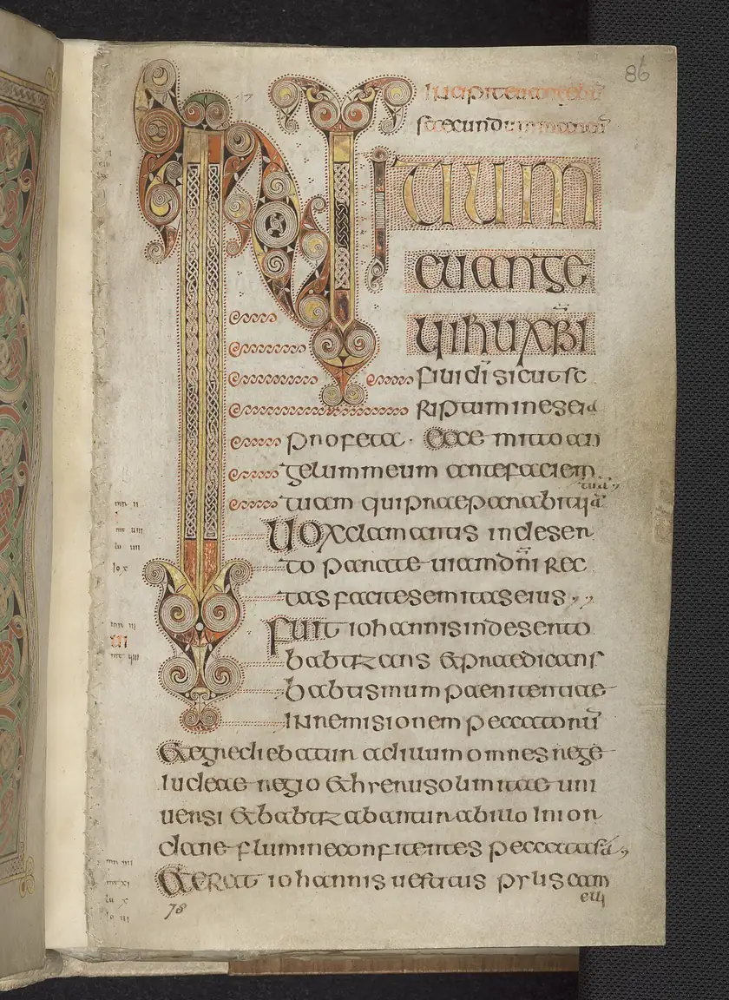
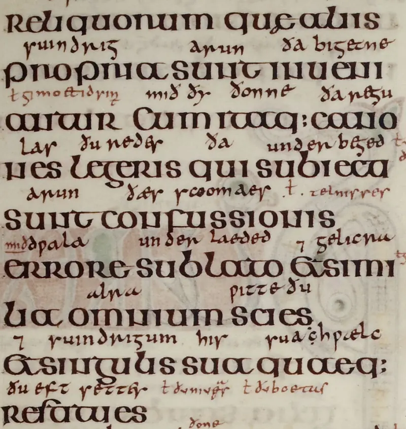

# Insular Scripts

Insular scripts are a family of medieval handwriting styles associated with
Ireland and Britain and carried to continental Europe through religious and
scholarly networks. They include the rounded lettering of richly decorated
Gospel books and smaller, more compact hands used for other kinds of writing.
Their history connects some of the most celebrated medieval manuscripts with
the practical work of copying, studying, and transmitting texts
([Stokes][stokes] 213–15; [“SFI-IRC Pathway Project”][early-irish-hands]).

## Origin and Development

Insular writing developed from the Latin scripts available to early medieval
scribes. Its beginnings remain difficult to reconstruct because important early
witnesses are not securely dated. The relationship between formal bookhands and
more cursive writing is also debated: scholars have proposed development from
formal scripts towards quicker hands, movement in the opposite direction, or
interaction between both. A recognisable Insular system emerged by the seventh
century, although its earliest stages resist a precise chronology
([Stokes][stokes] 215, 220).

The word “Insular” refers to the islands, but the writing tradition extended
beyond them. Monasteries, travelling scholars, and missionary communities
connected Ireland, Britain, and continental centres. These connections
complicate attempts to assign a manuscript to a modern country simply because
its handwriting looks “Irish” or “English”. Michelle P. Brown's discussion of
the Echternach Gospels, for example, places their production within a shared
tradition whose practitioners could have different origins while receiving
related training. Letterforms travelled with people, books, and exemplars
([773–74][brown]).

## Characteristics

The two broad grades are Insular majuscule, often called Insular half-uncial,
and Insular minuscule. Each includes variation in form and execution
([Stokes][stokes] 213–15). Formal half-uncial has a broad, rounded appearance,
with short projections above and below the main bodies of
letters. The resulting lines can look remarkably compact and even. “Majuscule”
does not mean that every letter resembles a modern capital: these hands combine
forms that modern readers might associate with uppercase and lowercase writing.
Olga Bleskina's examination of the eighth-century Insular Gospels in
St Petersburg illustrates this mixture within a formal bookhand
([sec. 5][bleskina]).

Several details help distinguish Insular writing. Wedge-shaped beginnings
appear at the tops of strokes. The *g* commonly has a flat top, while minuscule
*d* can have a backward-sloping ascender. Insular minuscule forms of *f*, *r*,
and *s* generally extend below the writing line, with their upper portions
remaining relatively low. These features work together: identifying a hand
requires attention to combinations of forms rather than one unusual letter.
The contrast with [Caroline minuscule](caroline-minuscule.md) becomes especially
useful when comparing manuscripts or passages written in different traditions
([Stokes][stokes] 226).

Scribes also used ligatures, which join letters, and abbreviations that shorten
words or syllables. One familiar sign is the Tironian *et*, ⁊, which resembles a
figure seven and represents “and”. Other abbreviations include a hooked *h* for
Latin *autem* and a reversed *c* for *con-*. Reading therefore involves learning
conventions as well as recognising an alphabet. A sign that looks unfamiliar
may represent several letters, while connected letterforms may form a ligature
([“Insular Scripts”][ad-fontes]).

## Usage and Importance

Insular manuscripts preserve more than biblical texts. An early copy of
Adomnán's *Life of Columba*, now Schaffhausen, Stadtbibliothek, Gen. 1, provides
an example of writing used to transmit a saint's biography. The manuscript has
two columns of writing ([Gamper and Marti][columba]). On page 4, a large initial
introduces a passage, followed by letters that decrease towards the size of the
surrounding script. This
*diminuendo* visually distinguishes the opening from the surrounding text
([“Insular Scripts”][ad-fontes]).

{ loading=lazy decoding=async width=904 height=412 }
*Fig. 1. Diminuendo in Adomnán's Life of Columba, Gen. 1, p. 4 (detail).
[Stadtbibliothek, Schaffhausen, on DMMapp](../../libraries/id-442.md).
Image: e-codices, reproduced in [Ad fontes][ad-fontes];
[CC0 1.0][cc0]. Converted to WebP.*

The Book of Armagh offers another useful comparison. Folio 159v begins with a
large decorated *A*, followed by compact writing arranged as numbered extracts
from Revelation. The thin, elongated strokes and numerous abbreviated forms
create a different visual effect from the broad lettering of a formal Gospel
page. Even here, however, decoration and practical organisation coexist: the
initial marks an opening, while the numbered sequence divides the material
into recognisable units. Comparing this page with a formal half-uncial
manuscript makes the variety within Insular writing immediately visible
([Stokes][stokes] 216–17, plate 15.2).

Handwriting also provides evidence about manuscript production. In her study
of the St Petersburg Insular Gospels, Bleskina identifies three scribes by
combining differences in script with ruling, quire structure, and decoration.
Her reconstruction suggests that the scribes prepared writing surfaces,
organised gatherings, added text, and supplied ornament. The finished
manuscript brings these activities together, but their traces remain visible.
Script therefore helps researchers investigate the people and working
practices behind a book, as well as the words it contains
([secs. 5–6][bleskina]).

## Representative Manuscripts

### Book of Durrow

The Book of Durrow, Dublin, Trinity College, MS 57, is among the earliest
surviving extensively decorated Insular Gospel books. Dated to approximately
650–700, it contains clear Insular majuscule writing alongside ornamented
pages. Its precise place of production remains disputed, with Ireland, Iona,
and Northumbria featuring in the discussion. Trinity's description associates
its maker with the Columban network of churches, illustrating how religious
affiliation can be more useful than modern national boundaries when describing
early manuscript culture ([Library of Trinity College Dublin][durrow]).

{ loading=lazy decoding=async width=840 height=1152 }
*Fig. 2. The opening of Mark's Gospel in the Book of Durrow, MS 57, fol. 86r.
[Trinity College Dublin on DMMapp](../../libraries/id-332.md).
Image © The Board of Trinity College Dublin, Digital Collections Department;
[source and rights][durrow-image], [CC BY 4.0][cc-by].
Resized and converted to WebP.*

Durrow's writing also contains variation within its formal appearance. The
*Earlier Latin Manuscripts* catalogue records alternative forms of several
letters and notes more fluent writing on folio 116. Such details remind us
that a named script is a description of shared practices, with room for
differences in execution and formality ([“Volume / Number”][durrow-cla]).

### Book of Kells

The Book of Kells, Dublin, Trinity College, MS 58, dates to around 800 and
contains texts of the four Gospels with preliminary material. Its decorated
initials and elaborated words make writing central to the visual experience
of the book ([“About the Book of Kells”][kells]). Folio 183v demonstrates this
relationship particularly clearly. Large coloured initials interrupt and
organise the dark lines of text,
while elongated strokes contribute to the visual arrangement of individual
lines. The page combines repeated letterforms with conspicuous variations in
scale. Its visual richness depends on the interaction between the ordinary
writing and the exceptional letters ([Stokes][stokes] 214–15, plate 15.1;
[Ní Ghormáin][kells-mark]).

### Lindisfarne Gospels

The Lindisfarne Gospels, London, British Library, Cotton MS Nero D IV, provide
a further major example. Brown argues for production around 715–720 and
interprets the book within the religious culture surrounding St Cuthbert
([769, 773][brown]). Its later history adds another layer of evidence. In the
tenth century, Aldred supplied an interlinear Old English
translation and a colophon naming Eadfrith as the original scribe. The colophon
is valuable testimony, although it was written considerably later than the
Gospel text. The manuscript thus preserves successive acts of writing and
interpretation within one volume ([“Cotton MS Nero D IV”][lindisfarne]).

{ loading=lazy decoding=async width=800 height=846 }
*Fig. 3. Latin text and Aldred's interlinear Old English gloss in the
Lindisfarne Gospels, Cotton MS Nero D IV, fol. 5r (detail).
[The British Library on DMMapp](../../libraries/id-49.md).
Image: British Library, via [Wikimedia Commons][lindisfarne-image];
[public domain][public-domain]. Resized and converted to WebP.*

## Later Development and Legacy

Insular writing changed at different rates in different regions. In England,
tenth-century square minuscule takes its name from the proportions of letters
such as *a*, *n*, and *u*. Caroline minuscule increasingly served Latin texts,
while forms descended from Insular writing remained important for Old English.
A manuscript or charter could consequently contain different scripts associated
with different languages. This makes the transition more complicated than the
replacement of one alphabet by another: scribes could maintain distinctions
and select forms according to what they were writing
([“Insular Scripts”][ad-fontes]).

In Ireland, the tradition had a much longer afterlife. Its descendants
contributed to Gaelic writing and printing, including *an Cló Gaelach*, which
remained widely used into the twentieth century
([“SFI-IRC Pathway Project”][early-irish-hands]). Trinity's
*Early Irish Hands* project connects this familiar visual inheritance with
research into its medieval origins
([“SFI-IRC Pathway Project”][early-irish-hands]). The
survival of recognisable forms should not obscure the development between
early manuscripts and later typography, but it demonstrates the lasting
cultural importance of the tradition.

For readers exploring medieval manuscripts today, Insular scripts offer a
rewarding starting point. Comparing the columns of the *Life of Columba*, the
numbered extracts in the Book of Armagh, and the decorated text of Kells reveals
different solutions to arranging writing on a page. Attention to those choices
brings the manuscript into focus as an object made for readers, shaped by
trained hands and adapted to particular purposes.

The manuscript images retain the individual rights statements linked in their
captions. The repository's CC0 dedication does not replace those terms.

## Works Cited

“About the Book of Kells.” *Trinity College Dublin*,
[www.tcd.ie/about/content/bookofkells_index.php][kells]. Accessed 30 Oct. 2026.

Bleskina, Olga. “Eighth-Century Insular Gospels (NLR, Lat. F.v.I.8):
Codicological and Palaeographical Aspects.” Translated by Olga Timofeeva,
*Studies in Variation, Contacts and Change in English*, vol. 9, 2012,
[varieng.helsinki.fi/series/volumes/09/bleskina/][bleskina]. Accessed
30 Oct. 2026.

Brown, Michelle P. “The Lindisfarne Scriptorium.” *The Oxford Handbook of
Latin Palaeography*, edited by Frank T. Coulson and Robert G. Babcock,
Oxford UP, 2020, pp. 769–78.
[https://doi.org/10.1093/oxfordhb/9780195336948.013.7][brown].

“Column of Preface from Lindisfarne Gospels.png.” *Wikimedia Commons*,
23 Nov. 2021,
[commons.wikimedia.org/wiki/File:Column_of_preface_from_Lindisfarne_Gospels.png][lindisfarne-image].
Accessed 30 Oct. 2026.

“Cotton MS Nero D IV.” *Archives and Manuscripts Catalogue*, British Library,
[searcharchives.bl.uk/catalog/040-001102725][lindisfarne]. Accessed
30 Oct. 2026.

Gamper, Rudolf, and Susan Marti. *Katalog der mittelalterlichen Handschriften
der Stadtbibliothek Schaffhausen*. Urs Graf Verlag, 1998, pp. 67–68.
*e-codices*, description of Schaffhausen, Stadtbibliothek, Gen. 1, updated by
Rudolf Gamper, 2008,
[www.e-codices.unifr.ch/de/description/sbs/0001][columba]. Accessed
30 Oct. 2026.

“Insular Scripts.” *Ad fontes*, University of Zurich,
[www.adfontes.uzh.ch/en/tutorium/schriften-lesen/schriftgeschichte/unziale-und-halbunziale][ad-fontes].
Accessed 30 Oct. 2026.

Library of Trinity College Dublin. “The Book of Durrow f.125v.” *Google Arts
& Culture*,
[artsandculture.google.com/asset/the-book-of-durrow-f-125v/oAGiyfKYdB-h2g][durrow].
Accessed 30 Oct. 2026.

Ní Ghormáin, Caoimhe. “Folios 183v–184r, Gospel of Mark.” *Visit Trinity*,
5 Nov. 2024,
[www.visittrinity.ie/book-of-kells-pages-on-display/gospel-of-mark/][kells-mark].
Accessed 30 Oct. 2026.

“SFI-IRC Pathway Project ‘Early Irish Hands: The Development of Writing in
Early Ireland.’” *School of Histories & Humanities*, Trinity College Dublin,
[histories-humanities.tcd.ie/research/hands/][early-irish-hands]. Accessed
30 Oct. 2026.

Stokes, Peter A. “Insular Script.” *The Oxford Handbook of Latin Palaeography*,
edited by Frank T. Coulson and Robert G. Babcock, Oxford UP, 2020, pp. 213–33.
[https://doi.org/10.1093/oxfordhb/9780195336948.013.108][stokes].

Trinity College Dublin Library, Digital Collections Department.
“IE TCD MS 57 f.86r.jpg.” *Wikimedia Commons*, 19 Mar. 2026,
[commons.wikimedia.org/wiki/File:IE_TCD_MS_57_f.86r.jpg][durrow-image]. Accessed
30 Oct. 2026.

“Volume / Number: 2 / 273.” *Earlier Latin Manuscripts*, University of Galway,
7 Apr. 2022, [elmss.universityofgalway.ie/catalogue/592][durrow-cla]. Accessed
30 Oct. 2026.

[Discover the DMMapp](../../index.md){ .md-button .md-button--primary }

[ad-fontes]: https://www.adfontes.uzh.ch/en/tutorium/schriften-lesen/schriftgeschichte/unziale-und-halbunziale
[bleskina]: https://varieng.helsinki.fi/series/volumes/09/bleskina/
[brown]: https://doi.org/10.1093/oxfordhb/9780195336948.013.7
[cc0]: https://creativecommons.org/publicdomain/zero/1.0/
[cc-by]: https://creativecommons.org/licenses/by/4.0/
[columba]: https://www.e-codices.unifr.ch/de/description/sbs/0001
[durrow]: https://artsandculture.google.com/asset/the-book-of-durrow-f-125v/oAGiyfKYdB-h2g?hl=en
[durrow-cla]: https://elmss.universityofgalway.ie/catalogue/592
[durrow-image]: https://commons.wikimedia.org/wiki/File:IE_TCD_MS_57_f.86r.jpg
[early-irish-hands]: https://histories-humanities.tcd.ie/research/hands/
[kells]: https://www.tcd.ie/about/content/bookofkells_index.php
[kells-mark]: https://www.visittrinity.ie/book-of-kells-pages-on-display/gospel-of-mark/
[lindisfarne]: https://searcharchives.bl.uk/catalog/040-001102725
[lindisfarne-image]: https://commons.wikimedia.org/wiki/File:Column_of_preface_from_Lindisfarne_Gospels.png
[public-domain]: https://creativecommons.org/publicdomain/mark/1.0/
[stokes]: https://doi.org/10.1093/oxfordhb/9780195336948.013.108
