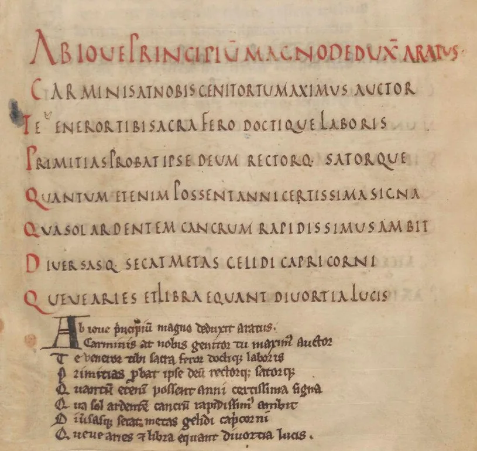

# Rustic Capitals: Roman Letters with a Medieval Afterlife

Open [folio 2r of the Leiden *Aratea*][aratea-folio] and you will find two versions of
the same Latin poem. Large capitals carry the ninth-century text; a later hand
has copied it in smaller Gothic writing below. The contrast shows both the
medieval life of Roman letterforms and a later reader's difficulty with them
([“Phaenomena / Aratus”][leiden-record]). The capitals belong to the tradition
conventionally called **Rustic Capitals**, or *capitalis rustica*.

## What Is Rustic About Them?

The name can mislead: it does not mean that these letters were carelessly made.
David Wright traces “Rustic” as a name for this capital script to an
eighteenth-century treatise ([“Mature Rustic Capitals”][wright]). The richly
illustrated Vatican Virgil, for example, is an elegant book written in Rustic
Capitals ([“Vergilius Vaticanus”][utah-virgil]). Bernhard Bischoff also uses
the term *canonical capitalis* for this kind of formal bookhand
([“Preliminary Remarks”][bischoff]). These are scholarly names; the letters
themselves offer a more useful way to recognise the script.

Square Capitals are a formal Roman book script related in shape to monumental
inscriptional lettering. Rustic Capitals usually have narrower, more closely
spaced letters. Both belong to the capital alphabet
([“Capitalis Quadrata and Capitalis Rustica”][ad-fontes]). Rustic Capitals are
a **majuscule**: their letters sit principally between two imaginary horizontal
lines. Individual forms can nevertheless extend beyond that pattern
([“Capitalis Quadrata and Capitalis Rustica”][ad-fontes];
[Anderson et al.][anderson] 135).

The early papyrus of Gallus's poetry shows how much the widths can vary within
one hand: its first editors describe *E*, *I*, *S*, and *T* as very narrow but
*M* as wide ([Anderson et al.][anderson] 135). In the later Vatican Virgil,
*N* is nearly square, *M* spreads beyond that shape, *V* can round towards a
*U*-like form, and *T* may have a gently waving top
([Wright, “Mature Rustic Capitals”][wright]). These are features of particular
hands. Look for a combination of proportions and strokes rather than one
unusual character.

## Earlier Witnesses and Public Lettering

The illustrated parchment codices of late antiquity are not the beginning of
the story. Literary papyri from Herculaneum preserve comparable capital
bookhands from before the eruption of 79 CE. The papyrus fragments of Gallus's
poetry found at Qaṣr Ibrîm provide another early witness. Their first editors
favoured a copy date in the later first century BCE, while allowing a wider
range ([Anderson et al.][anderson] 127–28, 135).
Fragments establish that a form of writing existed; they cannot show the full
range of books or hands once produced in it.

Rustic Capitals were also visible outside books. In Pompeii, painted public
notices, including electoral announcements, commonly used long, narrow
capitals with varied stroke widths and distinct serifs. These are painted
notices, rather than the scratched graffiti often associated with the city.
Eeva-Maria Viitanen finds variation even among the painted examples, which
were generally made without guidelines. Experienced painters probably made
most of them, alongside less practised contributors
([306, 313–14][viitanen]). Related letterforms could serve a public wall and a
literary page without making those objects identical in purpose or execution.

## Reading the Vatican Virgil

The *Vergilius Vaticanus* contains surviving parts of Virgil's *Georgics* and
*Aeneid*. The Vatican Library dates its principal manuscript to the fourth
century. Seventy-five leaves survive; folio 76 belongs to another,
fifth-century Virgil manuscript
([“Vat. lat. 3225”][vatican-virgil]). The book's illustrated pages and expert
writing make clear why “rustic” should not be taken as a judgement of quality
([“Vergilius Vaticanus”][utah-virgil]).

Its text is written in *scriptio continua*: words run together without regular
spaces. A reader must divide the sequence into words even after recognising
the letters ([“Vergilius Vaticanus”][utah-virgil]). Script and layout both
contribute to the work of reading.

The *Vergilius Romanus*, Vat. lat. 3867, is a different manuscript. The Vatican
Library assigns it to the fifth or sixth century and also describes its
writing as book capitals ([“Vat. lat. 3867”][roman-virgil]). The two books show
why a script category alone does not identify a particular hand or fix an exact
date.

## A Medieval Second Career

Capitals continued to mark headings, openings, and other distinguished parts
of medieval texts. Their role was not confined to short passages. The
*Utrecht Psalter*, now Utrecht University Library, MS 32, uses *capitalis
rustica* for its psalm text. Utrecht University dates the book to around 830
and places its likely production in Reims or nearby Hautvillers
([“The Utrecht Psalter”][utrecht]). A Roman-looking script could thus carry the
main text of a Carolingian book, rather than serving only as decoration.

In the Leiden *Aratea*, Leiden University Libraries, VLQ 79, Rustic Capitals
carry Germanicus's Latin version of Aratus's astronomical poem. The library
dates the book to the first half of the ninth century and identifies three
scribes in the original manuscript ([“Phaenomena / Aratus”][leiden-record]).
On folio 2r, the opening *ABIOVE* appears in capitals above a smaller copy of
the same Latin text. The lower writing is a transcription, not a translation
into another language ([*Aratea*, fol. 2r][aratea-folio]).

{ loading=lazy decoding=async width=815 height=770 }
*Fig. 1. Two scripts on folio 2r of the Leiden Aratea, Leiden University
Libraries, VLQ 79 (detail).
[Leiden University Libraries on DMMapp](../../libraries/id-364.md).
Image: Leiden University Libraries, via [Wikimedia Commons][aratea-commons];
[Public Domain Mark 1.0][public-domain]. Cropped from scan page 6 and
converted to WebP.*

The later transcription is in Gothic *textualis*. Leiden's catalogue assigns
it to the thirteenth century, while Ivana Dobcheva's manuscript description
places it in the second half of the twelfth. The secure point for this
comparison is its later date and different script, not an agreed century
([“Phaenomena / Aratus”][leiden-record]; [Dobcheva][dobcheva]). The page
preserves both the prestige of an inherited bookhand and a later response to
the difficulty of reading it.

Other manuscripts arrange several scripts within one book. In the
*Benedictional of St Æthelwold*, London, British Library, Add MS 49598, Godeman
wrote the main text in large Caroline minuscule. The opening lines of blessings
use Rustic Capitals, Square Capitals, or uncial according to the occasion.
These changes help distinguish parts of a book made for a bishop whose tenure
at Winchester ran from 963 to 984 ([“Add MS 49598”][benedictional]).

## Looking Beyond the Label

Ask what the capitals are doing on each page. In the Vatican Virgil they carry
a late antique literary text. In the Utrecht Psalter and Leiden *Aratea*, they
carry main texts in ninth-century books. In Æthelwold's benedictional, they
help mark significant openings. The same broad script tradition served
different readers and purposes.

Return to [Leiden folio 2r][aratea-folio]: compare repeated capitals in the upper
lines, then look at the later transcription beneath them. The contrast makes
the page evidence for how an older script could be preserved, encountered,
and reread.

## Works Cited

“Add MS 49598.” *Archives and Manuscripts Catalogue*, British Library,
[searcharchives.bl.uk/catalog/032-002016414][benedictional]. Accessed
9 Nov. 2026.

Anderson, R. D., et al. “Elegiacs by Gallus from
Qaṣr Ibrîm.” *The Journal of Roman Studies*, vol. 69, 1979, pp. 125–55.
[https://doi.org/10.2307/299064][anderson].

*Aratea*. First half of the ninth century. MS Voss. lat. Q 79, Leiden
University Libraries. [Digitised manuscript][aratea]. Accessed 9 Nov. 2026.

Bischoff, Bernhard. “Preliminary Remarks.” *Latin Palaeography: Antiquity and
the Middle Ages*, translated by Dáibhí Ó Cróinín and David Ganz, Cambridge UP,
1990, pp. 51–53. [https://doi.org/10.1017/CBO9780511809927.007][bischoff].

“Capitalis Quadrata and Capitalis Rustica.” *Ad fontes*, University of Zurich,
[www.adfontes.uzh.ch/en/tutorium/schriften-lesen/schriftgeschichte/capitalis-quadrata-und-rustica][ad-fontes].
Accessed 9 Nov. 2026.

Dobcheva, Ivana. “Leiden, Universitaire Bibliotheken, VLQ 79.” *Aratea
Digital*, 31 May 2018, [ivanadob.github.io/aratea-data/desc__leiden_ub_vlq_79.html][dobcheva].
Accessed 9 Nov. 2026.

“Leiden Aratea (Leiden University Libraries).pdf.” *Wikimedia Commons*,
21 Feb. 2026, [commons.wikimedia.org/wiki/File:Leiden_Aratea_(Leiden_University_Libraries).pdf][aratea-commons].
Accessed 9 Nov. 2026.

“Phaenomena / Aratus.” *Leiden University Libraries Catalogue*, shelfmark
VLQ 79, [hdl.handle.net/1887.1/item:4152891][leiden-record]. Accessed
9 Nov. 2026.

“The Utrecht Psalter.” *Special Collections*, Utrecht University,
[www.uu.nl/en/special-collections/the-treasury/manuscripts/the-utrecht-psalter][utrecht].
Accessed 9 Nov. 2026.

“Vat. lat. 3225.” *DigiVatLib*, Biblioteca Apostolica Vaticana,
[digi.vatlib.it/mss/detail/210481][vatican-virgil]. Accessed 9 Nov. 2026.

“Vat. lat. 3867.” *DigiVatLib*, Biblioteca Apostolica Vaticana,
[digi.vatlib.it/mss/detail/210493][roman-virgil]. Accessed 9 Nov. 2026.

“Vergilius Vaticanus.” *Medieval Manuscript Facsimiles*, J. Willard Marriott
Library, University of Utah,
[lib.utah.edu/collections/rarebooks/database/medieval-manuscript-facsimiles/roman-classics/vergilius-vaticanus.php][utah-virgil].
Accessed 9 Nov. 2026.

Viitanen, Eeva-Maria. “Painting Signs in Ancient Pompeii: Contextualizing
*scriptores* and Their Work.” *Arctos: Acta Philologica Fennica*, vol. 54,
2020, pp. 285–331. [https://doi.org/10.71390/arctos.110093][viitanen].

Wright, David. “Capital Scripts.” *The Oxford Handbook of Latin Palaeography*,
edited by Frank T. Coulson and Robert G. Babcock, Oxford UP, 2020,
pp. 79–97. [https://doi.org/10.1093/oxfordhb/9780195336948.013.98][wright].

[Discover the DMMapp](../../index.md){ .md-button .md-button--primary }

[anderson]: https://doi.org/10.2307/299064
[ad-fontes]: https://www.adfontes.uzh.ch/en/tutorium/schriften-lesen/schriftgeschichte/capitalis-quadrata-und-rustica
[aratea]: https://hdl.handle.net/1887.1/item:4152891
[aratea-folio]: https://commons.wikimedia.org/w/index.php?title=File:Leiden_Aratea_(Leiden_University_Libraries).pdf&page=6
[aratea-commons]: https://commons.wikimedia.org/wiki/File:Leiden_Aratea_(Leiden_University_Libraries).pdf
[benedictional]: https://searcharchives.bl.uk/catalog/032-002016414
[bischoff]: https://doi.org/10.1017/CBO9780511809927.007
[dobcheva]: https://ivanadob.github.io/aratea-data/desc__leiden_ub_vlq_79.html
[leiden-record]: https://hdl.handle.net/1887.1/item:4152891
[public-domain]: https://creativecommons.org/publicdomain/mark/1.0/
[roman-virgil]: https://digi.vatlib.it/mss/detail/210493
[utrecht]: https://www.uu.nl/en/special-collections/the-treasury/manuscripts/the-utrecht-psalter
[utah-virgil]: https://lib.utah.edu/collections/rarebooks/database/medieval-manuscript-facsimiles/roman-classics/vergilius-vaticanus.php
[vatican-virgil]: https://digi.vatlib.it/mss/detail/210481
[viitanen]: https://doi.org/10.71390/arctos.110093
[wright]: https://doi.org/10.1093/oxfordhb/9780195336948.013.98
